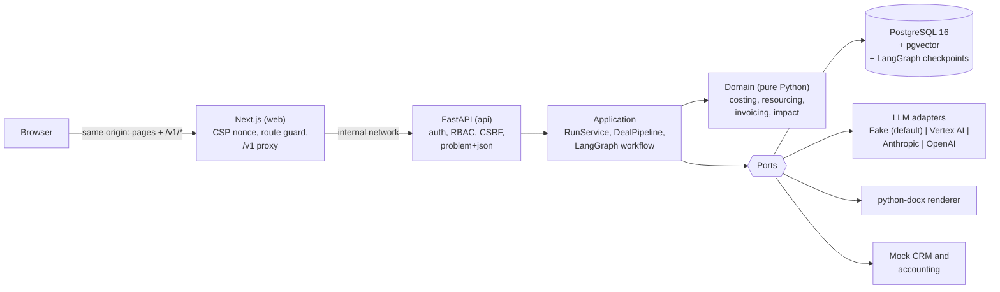

# Deal Desk

Upload a client brief (RFP as PDF or text) and get a costed, resourced, cited proposal that a
human approves before anything is recorded. **All data is synthetic (SAMPLE). Nothing here is real
client or company data.**

What happens to a brief:

1. Requirements are extracted (and prompt-injection attempts are quarantined).
2. Hours by role are proposed, grounded in similar SAMPLE past projects (pgvector retrieval).
3. Cost, price and margin are calculated **in code** (`Decimal`), with margin-policy flags and the
   price needed to hit target margin. Below the minimum margin, the estimate is revised (hours or
   scope, never rates) at most twice, then escalated.
4. Hours are checked against team availability; over-booked person-weeks are flagged.
5. A Word proposal is drafted with cited case studies, marked "DRAFT, requires approval".
6. An approver who did not create the run approves or rejects (with a comment).
7. On approval a pipeline record and a 30/40/30 invoice schedule (net, VAT, gross) are created.
8. An impact panel shows hours, money and capacity (FTE) saved, with every input an assumption.

## Quickstart (Docker and Make only)

```bash
cp .env.example .env    # optional: `make demo` creates it if missing
make demo               # generates local secrets, builds, starts, migrates and seeds
open http://localhost:3000
```

`make demo` prints where the demo credentials are: the `DEMO_*_EMAIL` and `DEMO_*_PASSWORD` entries
in your git-ignored `.env`, generated randomly by `make init` (one user per role: admin, estimator,
approver, viewer). There are no default passwords anywhere in the repository.

**Offline by default.** The default model provider is a deterministic fake (`LLM_PROVIDER=fake`).
With it, no brief text leaves your machine and no cloud credentials are needed. If you configure a
real provider, brief text is sent to that provider.

## Architecture



Hexagonal: the domain imports nothing from frameworks (enforced by import-linter and a test), the
application depends only on the domain and ports, and adapters implement the ports. See
[docs/ARCHITECTURE.md](docs/ARCHITECTURE.md).

## Switching to a real model provider

Set these in `.env` and restart (`make up`). Model names come only from configuration.

| Provider | Settings |
| --- | --- |
| Google Vertex AI | `LLM_PROVIDER=vertex`, `LLM_MODEL=<model id>`, `GOOGLE_CLOUD_PROJECT`, `GOOGLE_CLOUD_LOCATION`; credentials from Application Default Credentials. Optionally `EMBEDDING_PROVIDER=vertex` and `EMBEDDING_MODEL`. |
| Anthropic | `LLM_PROVIDER=anthropic`, `LLM_MODEL=<model id>`, `ANTHROPIC_API_KEY` |
| OpenAI | `LLM_PROVIDER=openai`, `LLM_MODEL=<model id>`, `OPENAI_API_KEY`; optionally `EMBEDDING_PROVIDER=openai` |

The API refuses to start if a selected provider is missing its settings. If you change the
embedding provider, re-run `make seed` so the SAMPLE reference data is re-embedded.

## Tests, checks and evals

| Command | What it runs |
| --- | --- |
| `make check` | ruff, mypy `--strict`, import-linter layer rules, pytest (unit + integration against real Postgres) with an 85% overall and 100% `domain/` branch-coverage gate, ESLint, Prettier, TypeScript strict, stale-client check, Vitest |
| `make eval` | Offline evals against recorded FakeLLM fixtures: schema validity, requirement recall, and that the injection brief changes no computed number |
| `make eval-live` | The same evals against the configured real provider |
| `make e2e` | Playwright (official image) against the full Compose stack, with axe accessibility checks |
| `make tf-validate`, `make helm-lint` | Terraform fmt/validate and Helm lint/template (nothing is applied) |
| `make audit`, `make image-scan`, `make secrets-scan` | pip-audit and npm audit; Trivy on both runtime images; gitleaks over the history |

## Limitations (honest)

- The default model is a deterministic rule-based fake: extraction quality on real tenders is
  limited. Real providers are wired and unit-tested with stubbed SDK clients, but were not called
  while building this (no credentials were used).
- The CRM and accounting systems are mocks (local tables).
- Workflow runs execute in an in-process thread pool and resume after a restart; a separate worker
  would be the scale-out path. Rate limiting is in memory per process.
- OIDC token validation is implemented and tested with a mocked JWKS; the optional Keycloak
  Compose profile was not built.
- Impact figures are assumptions and targets to be measured in a pilot, not results.

More: [docs/RUNBOOK.md](docs/RUNBOOK.md), [docs/SECURITY.md](docs/SECURITY.md),
[docs/ASSUMPTIONS.md](docs/ASSUMPTIONS.md), [docs/DEMO_SCRIPT.md](docs/DEMO_SCRIPT.md),
[docs/adr/](docs/adr/), [docs/SPEC.md](docs/SPEC.md).
