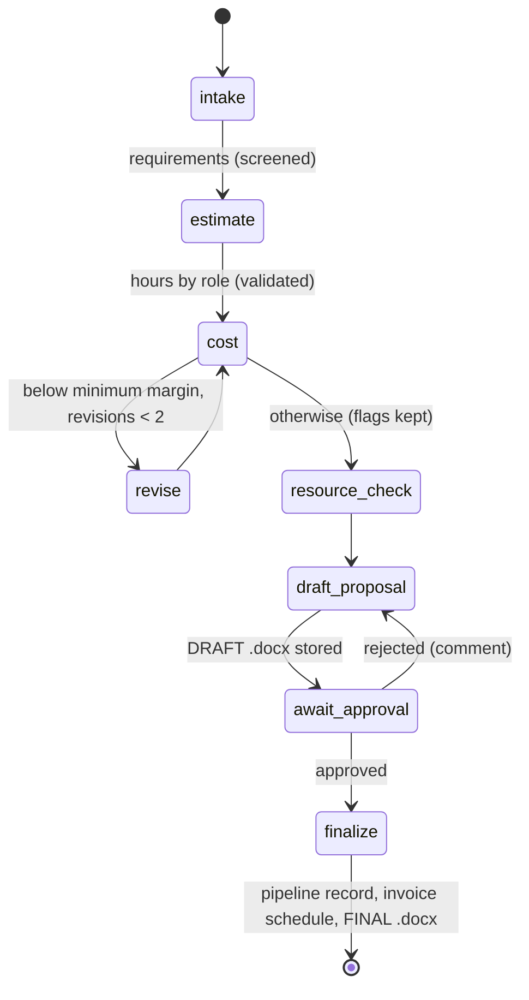

# Architecture

## Principles in one line each

- **Code computes, the model reads and writes.** Money, margin, dates, capacity and invoices are
  computed by `dealdesk.domain` with `Decimal`. The model extracts, proposes hours and drafts prose.
- **Ports and adapters.** Domain ← application ← adapters/API. import-linter enforces it.
- **Human in the loop.** The LangGraph workflow pauses at `await_approval`; nothing reaches the
  pipeline or invoice schedule without a recorded approval by someone other than the creator.
- **Untrusted input.** Briefs are data: delimited, screened, never given tools.

## Layers

| Package | Responsibility | May import |
| --- | --- | --- |
| `domain/` | Costing and margin policy, resourcing, invoicing, impact, approval rule. Pure, `Decimal`, no I/O | stdlib only |
| `ports/` | Protocols: repositories, `LLMPort`, `EmbedderPort`, `CRMPort`, `AccountingPort`, `DocumentStorePort`, `ProposalRendererPort` | domain, pydantic (schemas only) |
| `application/` | `DealPipeline` use cases, LangGraph workflow, `RunService`, runner, prompts, guardrails, schemas | domain, ports, langgraph |
| `adapters/` | Postgres (SQLAlchemy 2, pgvector, LangGraph checkpointer), LLM providers, embedders, docx, mocks, upload reader | everything below the API |
| `auth/` | `AuthPort`, Argon2id, EdDSA tokens, refresh rotation, OIDC, RBAC policy, CSRF, rate limiter | domain, ports |
| `api/` | FastAPI app, routers, middleware, problem+json, composition root | all |

## Request path

Browser → Next.js (`proxy.ts` sets a nonce CSP and guards pages; `app/v1/[...path]/route.ts`
forwards API calls) → FastAPI middleware (request id, security headers, body cap, rate limit, CSRF)
→ `require_permission(...)` (authenticate the cookie, load the user, check the central policy) →
router → application service → domain and ports.

## Workflow

- Graph state is small (run id, revision count, decision, comment). Step outputs are written to the
  `runs` row as JSON, so the API never reads checkpoints.
- Every node records a `run_steps` row (timing feeds the impact panel's measured machine time) and
  audit events: `step.completed`, and one `llm.call` per model call with prompt id and version,
  provider, model, tokens, latency, attempts and estimated spend.
- Runs execute in a thread pool. On API start-up, `WorkflowRunner.recover()` resumes runs that were
  queued or running, including a decision recorded just before a crash.
- Decisions use compare-and-set on the run status, so two approvers cannot both decide.

## Model layer

`StructuredLLM` wraps any provider client: timeouts, bounded exponential backoff for transient
errors, re-ask on schema failure, and summed token accounting. Outputs are validated with strict
Pydantic schemas (`extra="forbid"`; hours are pattern-checked strings, never floats). Prompts are
versioned files in `application/prompts/` with shared injection rules inlined. The fake provider is
deterministic and can replay recorded fixtures exactly (`make eval`).

## Data

PostgreSQL 16 with pgvector: users, refresh-token hashes, append-only audit log (a trigger rejects
UPDATE, DELETE and TRUNCATE), SAMPLE reference data with 256-dimension embeddings, runs, steps,
approvals, documents (bytea, so containers keep read-only root filesystems), mock CRM and invoice
tables, and LangGraph's checkpoint tables.

## Front end

Next.js App Router with TypeScript strict. TanStack Query for server state (polling every 2 s while
a run is active), React Hook Form and Zod for forms, Recharts for the impact chart, Radix-based
components. The API client is generated from FastAPI's OpenAPI document; CI fails if it is stale.
The browser never does money arithmetic: amounts arrive as decimal strings and are formatted as
strings; utilisation for the heatmap is computed by the server.
